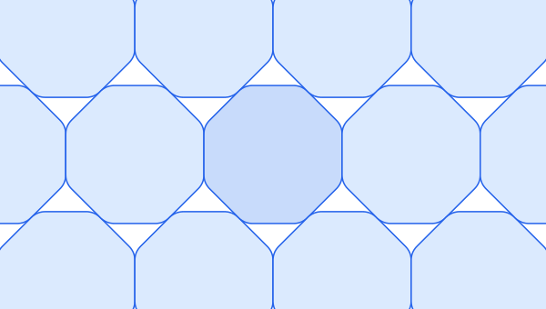
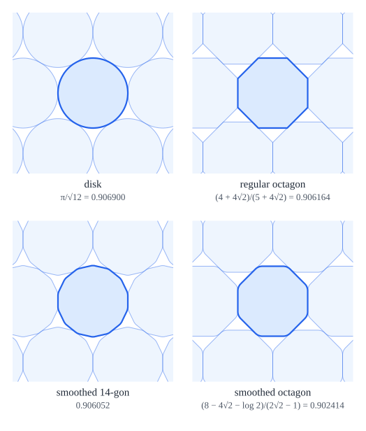
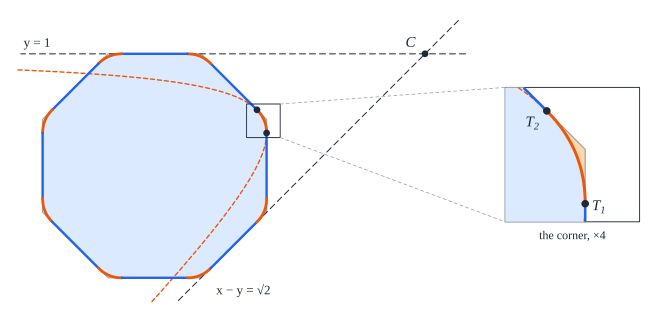
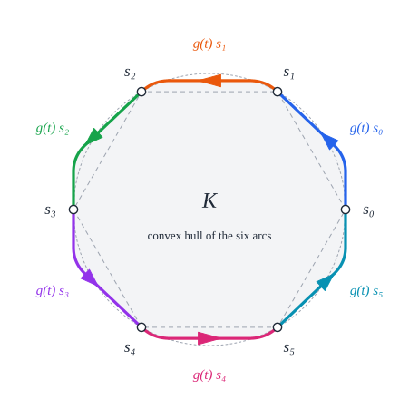
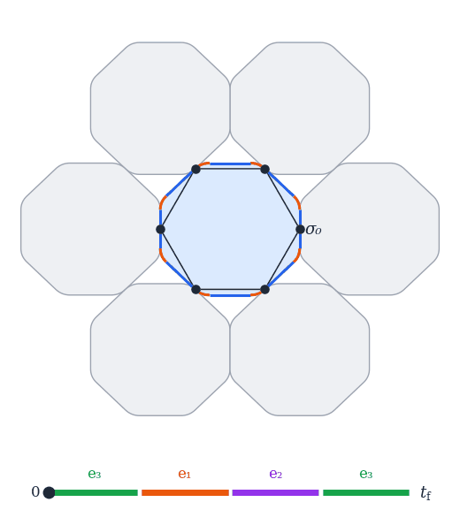

# The Reinhardt conjecture, in Lean 4

[](https://github.com/vltanh/lean4-smoothed-octagon/actions/workflows/lean_action_ci.yml?query=branch%3Amain)



Which centrally symmetric convex shape packs the plane worst? Pack copies of a disk as tightly as
possible and they cover `π/√12 = 90.69…%` of the plane; a regular octagon does a little worse. In
1934 Karl Reinhardt conjectured that the worst of all is the *smoothed octagon*, a regular octagon
whose corners are cut off by arcs of hyperbolas, with greatest packing density

  `δ_oct = (8 − 4√2 − log 2)/(2√2 − 1) = 0.902414…`,

and that it is the only worst shape up to affine maps. Kurt Mahler reached the same octagon
independently in 1947. The conjecture has been open since.



*Four shapes of the same inradius in their densest packings, from the best packer to the worst: the
disk, the regular octagon, a smoothed 14-gon (a regular 14-gon with its corners cut by hyperbolas in
the same way) and the smoothed octagon.*

This repository proves the conjecture, together with its equality case, in Lean 4 with Mathlib.
The proof was written here by ChatGPT Pro (OpenAI) and Claude Opus 5.5 (Anthropic). No person has
checked it; Lean's kernel checks every step, and every theorem depends only on Lean's standard
axioms `propext`, `Classical.choice` and `Quot.sound`.

For an interactive introduction, see the
[Smoothed Octagon Playground](https://vltanh.me/smoothed-octagon/).

## The smoothed octagon

The smoothed octagon has two equivalent definitions: Reinhardt's construction from a regular
octagon, which the Lean statements use, and Hales's description through a control problem, which
the proof works with. [`Bridge/Classical.lean`](SmoothedOctagon/Bridge/Classical.lean) proves that
the two give the same shape, up to a linear map.

### Reinhardt's construction



Take the regular octagon whose sides lie on the lines `x cos(kπ/4) + y sin(kπ/4) = 1`. Replace each
corner by the arc of the hyperbola `d · d' = √2/4` whose asymptotes are the next two side lines
(`d`, `d'` the distances to them); it touches the two sides at the corner. Each side keeps a
straight middle part of length `2 − √2`. In Lean this is `smoothedOctagon`.

### Hales's control problem

The smoothed octagon is the convex hull of the six arcs `t ↦ g(t) s_j`, `t ∈ [0, t_f]`, of the
trajectory `g` of Hales's control problem with the octagon's bang-bang control. Its area is the
cost of the trajectory, `√12 δ_oct`.



*The white dots `s₀, …, s₅` are the corners of a regular hexagon on the unit circle. The trajectory
`g` is a path of 2 × 2 matrices, and as `t` runs from `0` to `t_f`, `g(t)` carries each `s_j` along
one coloured arc, to where the next point `s_{j+1}` started. The six arcs join into one closed
convex curve, and the region it encloses, their convex hull, is the smoothed octagon. It is drawn
as Hales normalizes it: Reinhardt's octagon squeezed vertically by about 5%.*

## Statements

The statements are in [`Palomar/Challenge.lean`](Palomar/Challenge.lean), which imports only
Mathlib. Its definitions are copied word for word from
[`SmoothedOctagon/Defs.lean`](SmoothedOctagon/Defs.lean): `smoothedOctagon`, and the packing
definitions of [lean4-smoothed-polygon](https://github.com/vltanh/lean4-smoothed-polygon), the
formalization of Hales and Vajjha's *Packings of Smoothed Polygons* on which this project builds.

`greatestPackingDensity K` is the supremum of the densities of packings of the plane by congruent
copies of `K`.

```lean
theorem reinhardt (K : Set (Fin 2 → ℝ)) (hK : IsConvexDisk K)
    (hsymm : ∃ c : Fin 2 → ℝ, ∀ x ∈ K, (2 : ℝ) • c - x ∈ K) :
    (8 - 4 * √2 - Real.log 2) / (2 * √2 - 1) ≤ greatestPackingDensity K
```

| Theorem | In words |
| --- | --- |
| `octagon_density` | the smoothed octagon is a centrally symmetric convex disk of greatest packing density `δ_oct` |
| `reinhardt` | every centrally symmetric convex disk has greatest packing density at least `δ_oct` |
| `reinhardt_equality` | equality holds exactly for the images of the smoothed octagon under invertible affine maps |

## How the proof works

A shape like this (convex, and unchanged by a half turn) packs most densely in a grid: every copy is
the same shape shifted, never rotated, and each one touches six neighbours (Fejes Tóth). The density
is then the area of the shape divided by the area of one grid cell. Stretching or shearing the
picture scales both areas alike, so we may stretch it until the six touching points form a regular
hexagon. That fixes the grid, and the question becomes: among the shapes whose tightest grid is this
one, which has the smallest area?

A worst shape has a whole family of tightest grids, and its grid can slide from one to the next. As
it slides, the six contact points run around the edge of the shape, always forming a hexagon of the
same area, and together they trace its whole boundary. Thomas Hales turned this into a steering
problem. At every moment a control, chosen from a triangle of settings, decides how sharply the
contact points curve, and the area of the traced shape is the cost of the steering. Finding the
worst packer means finding the cheapest steering, an *optimal control* problem of the kind used to
plan a spacecraft's most fuel-efficient flight.



*The smoothed octagon (blue) and its six neighbours (grey) in a densest packing. The black dots are
where the neighbours touch it; the hexagon joining them keeps the same area throughout. As the
packing slides, the dots run along the straight sides (blue) and round the curved corners (orange).
The bar at the bottom shows the steering: each of the three settings `e₁`, `e₂`, `e₃` belongs to
one opposite pair of dots, and only that pair goes round a corner while the other four move along
straight sides. The white dots mark where the black dots start. Follow the dot labelled `σ₀`:
after four equal steps, `e₃ e₁ e₂ e₃`, it has reached the next white dot, where its neighbour
started. Every dot has moved on by one place, and the motion repeats.*

The Pontryagin maximum principle, a basic tool of optimal control, tells what the cheapest steering
looks like: it always holds one of the three extreme settings and switches between them only
finitely often. So a worst shape is built from straight segments and hyperbola arcs, and it is
described by its pattern of switches. The proof then goes through the patterns. Those with six or
more steps fall into five families, and none of them can be the cheapest. Those with at most five
steps are compared directly, and the cheapest is the octagon's four equal steps. No other pattern
matches its cost, so the octagon is the only worst shape, up to stretching and shearing.

The [Smoothed Octagon Playground](https://vltanh.me/smoothed-octagon/) lets you try this yourself:
pack the octagon yourself, build it corner by corner, look for a worse packer, and watch its
sliding packings.

## Status

[`SmoothedOctagon.lean`](SmoothedOctagon.lean), the root of the library, restates the three
theorems of [`Palomar/Challenge.lean`](Palomar/Challenge.lean) word for word and proves them,
with no hypothesis and no `sorry`. `scripts/Audit.lean` checks that all 8,294 declarations of the
library, and the three theorems, depend only on the standard axioms. The library builds with no
warning; the only ones in a build are the three `sorry`s of the Challenge, which states the
theorems without proving them.

| Stage | Lean |
| --- | --- |
| Foundations: realization of a worst disk, reverse comparison for arbitrary measurable controls | [`Foundations/`](SmoothedOctagon/Foundations) |
| Reduction: compact domain (Hales–Vajjha's Theorem 5.0.2), Pontryagin lift, clearance, edge bound, finitely many switches, normality | [`Reduction/`](SmoothedOctagon/Reduction) |
| The partition of switch-sign sequences into five classes | [`Period/Partition.lean`](SmoothedOctagon/Period/Partition.lean) |
| Cases R, M3, M1, F, M2 | [`Exclusion/`](SmoothedOctagon/Exclusion) |
| Terminal comparison: at most five pieces | [`Terminal/`](SmoothedOctagon/Terminal) |
| Equality and its converse | [`Equality/`](SmoothedOctagon/Equality) |
| The statements in the Challenge's vocabulary | [`SmoothedOctagon.lean`](SmoothedOctagon.lean), [`Bridge/`](SmoothedOctagon/Bridge) |
| Reinhardt's construction: the octagon of the trajectory is a linear image of it | [`Bridge/Classical.lean`](SmoothedOctagon/Bridge/Classical.lean) |

## Prior work

Reinhardt (1934) and Mahler (1947) posed the problem and found the octagon; Fejes Tóth showed that
densest packings of centrally symmetric disks can be taken to be lattice packings; Ledermann,
Ennola and Tammela proved lower bounds (Tammela's `0.8926`, 1970, stood for decades), and Nazarov
showed the smoothed octagon is a local minimum (1986). Hales recast the problem as optimal control
(2011, 2017), and Hales and Vajjha studied its Pontryagin extremals in *Packings of Smoothed
Polygons* (2024). [docs/prior-work.md](docs/prior-work.md) gives the full history with references.

## Verification

```sh
lake exe cache get
lake build
lake env lean scripts/Audit.lean          # every declaration uses only the standard axioms
lake env lake comparator --config=Palomar/comparator.json   # needs bubblewrap; the Solution proves the Challenge
python3 scripts/sync_challenge_defs.py --check     # the Challenge's definitions are the library's
python3 scripts/figures/make_figures.py   # the figures, with every illustrated fact asserted
```

The Palomar files are in [`Palomar/`](Palomar): the Challenge, the Comparator configuration and
[`formalization.yaml`](Palomar/formalization.yaml). The workflow `palomar_preflight.yml` runs
Palomar's verification on a commit.

Lean and Mathlib are pinned at `v4.36.0-rc2`. The project depends on
[lean4-smoothed-polygon](https://github.com/vltanh/lean4-smoothed-polygon) (Hales–Vajjha's book,
including the Pontryagin lift of a minimizer and Theorem 5.0.2) and, through it, on
[lean4-optimal-control](https://github.com/vltanh/lean4-optimal-control) (the maximum principle).
A full build of the library takes about 3.5 CPU-hours, about 18 minutes on 20 cores. No module
needs more than 7 GB of memory; CI builds the few that need more than 4 GB
(`scripts/ci/sequential-modules.txt`) one at a time, then the rest in parallel.

## Layout

```text
Palomar/                       the Challenge (the statements of record, in Mathlib's vocabulary) and
                               the Comparator configuration
SmoothedOctagon.lean           the main theorems, with their proofs (the Solution)
SmoothedOctagon/
  Foundations/                 geometry ↔ control: realization, reverse comparison
  Reduction/                   minimizer → finite normal period
  Period/                      vertex periods, flows, twist, Hamiltonians, the sign partition
  Exclusion/                   the five classes of sign sequences, each excluded
    Reverse/                   R: entirely reverse
    MinimumStructure/          M3: a reverse run of length other than two
    ShortRuns/                 M1: every forward run of length one
    Forward/                   F: entirely forward
    Mixed/                     M2: the windows around the global minimum of the active margins
      Nonshort/                the smaller-nonshort window: its reverse and forward successors
      SmallerShort/            the smaller-short window: the large-ratio, lower-ratio, upper-ratio,
                               displacement, Casimir-floor, shear and cost bounds
  Terminal/                    periods with at most five pieces
  Equality/                    rigidity and its converse
  Bridge/                      the Challenge's terms; Hales's octagon is a linear image of Reinhardt's
  Defs.lean                    the definitions of the statements, shared with the Challenge
  LowerBound.lean              the assembly
Cited/HalesVajjha/             Definition 5.0.1 of Hales–Vajjha (the compact domain)
docs/                          credits, prior work and the figures
scripts/                       the audit, the definitions check, the figures and the certificate generators
```

## Credits

The-Anh Vu-Le chose the problem and directed the work. ChatGPT Pro (OpenAI) drafted the argument,
and Claude Opus 5.5 (Anthropic), in Claude Code, wrote the Lean proof and organized it, with the
visualizations and this presentation.
The geometric and control-theoretic foundations come from
[lean4-smoothed-polygon](https://github.com/vltanh/lean4-smoothed-polygon) and
[lean4-optimal-control](https://github.com/vltanh/lean4-optimal-control). See
[`docs/CREDITS.md`](docs/CREDITS.md).

## License

Apache-2.0 ([`LICENSE`](LICENSE)).
