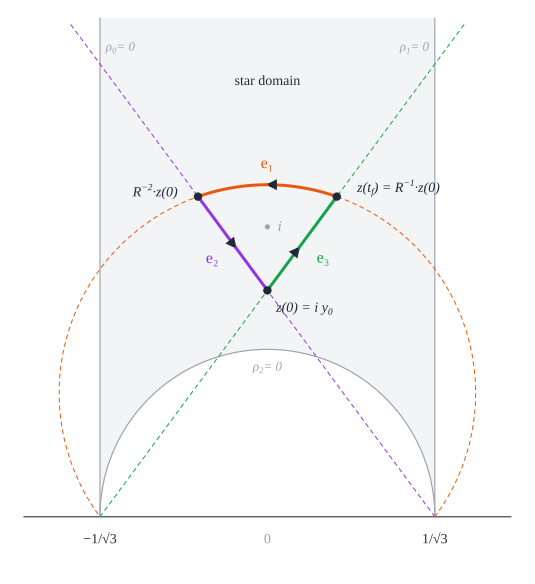

# The Reinhardt conjecture, in Lean 4

Which centrally symmetric convex shape packs the plane worst? Pack copies of a disk as tightly as
possible and they cover `π/√12 = 90.69…%` of the plane; a regular octagon does a little worse. In
1934 Karl Reinhardt conjectured that the worst of all is the *smoothed octagon*, a regular octagon
whose corners are cut off by arcs of hyperbolas, with greatest packing density

  `δ_oct = (8 − 4√2 − log 2)/(2√2 − 1) = 0.902414…`,

and that it is the only worst shape up to affine maps. Kurt Mahler reached the same octagon
independently in 1947. The conjecture has been open since.


The smoothed octagon packs most densely as a lattice packing, and it can do so in a continuum of
ways: the copies slide while always touching their six neighbours.

## The smoothed octagon


Take the regular octagon whose sides lie on the lines `x cos(kπ/4) + y sin(kπ/4) = 1`. Replace each
corner by the arc of the hyperbola `d · d' = √2/4` whose asymptotes are the next two side lines
(`d`, `d'` the distances to them); it touches the two sides at the corner. Each side keeps a
straight middle part of length `2 − √2`.


## Statements

All definitions are in [`Challenge.lean`](Challenge.lean), which imports only Mathlib. They are
copied word for word from [lean4-smoothed-polygon](https://github.com/vltanh/lean4-smoothed-polygon),
the formalization of Hales and Vajjha's *Packings of Smoothed Polygons* on which this project
builds. `greatestPackingDensity K` is the supremum of the densities of packings of the plane by
congruent copies of `K`.

```lean
theorem reinhardt (K : Set (Fin 2 → ℝ)) (hK : IsConvexDisk K)
    (hsymm : ∃ c : Fin 2 → ℝ, ∀ x ∈ K, (2 : ℝ) • c - x ∈ K) :
    (8 - 4 * √2 - Real.log 2) / (2 * √2 - 1) ≤ greatestPackingDensity K
```

| Theorem | In words |
| --- | --- |
| `reinhardt` | every centrally symmetric convex disk has greatest packing density at least `δ_oct` |
| `reinhardt_equality` | equality holds exactly for the images of the smoothed octagon under invertible affine maps |
| `reinhardt_cost` | every trajectory of Hales's control problem with the boundary conditions costs at least `√12 δ_oct` |
| `octagon_area` | the smoothed octagon, defined from its trajectory, has area `√12 δ_oct` and density `δ_oct` |

The smoothed octagon is defined as the convex hull of the six arcs `t ↦ g(t) s_j`, `t ∈ [0, t_f]`,
of the trajectory `g` of Hales's control problem with the octagon's bang-bang control; `octagon_area`
identifies it with Reinhardt's octagon.

## Proof outline

Following Hales, the problem becomes optimal control on `SL₂(ℝ)`. A worst disk, normalized so that
its critical hexagon is regular, is traced by six points `g(t) s_j` that slide along its boundary,
and its area is the cost `−(3/2) ∫ tr(J X)` of the trajectory `(g, X)`. Conversely every trajectory
of cost below `π`, with any measurable control, bounds such a disk.


1. **Foundations.** The conjecture is equivalent to a lower bound on the cost of every admissible
   trajectory, and the realization of a worst disk is a global minimizer of the control problem.
2. **Reduction.** A global minimizer stays in a compact part of the state space, lifts to a
   Pontryagin extremal (proved in lean4-smoothed-polygon from the maximum principle of
   [lean4-optimal-control](https://github.com/vltanh/lean4-optimal-control)), switches between the
   three vertices of the control simplex finitely many times, and is normal.
3. **Five cases.** Read cyclically, the switches of a minimizing period are forward or reverse.
   With six or more pieces the sign sequence falls in one of five classes, and each is excluded.
4. **Terminal comparison.** A period with at most five pieces costs at least `√12 δ_oct`, with
   equality only for the octagon's four-piece word `e₂ e₀ e₁ e₂` with equal durations.
5. **Equality.** The boundary realization of any worst disk is then the octagon's trajectory, so
   the disk is a linear image of the octagon; conversely linear images pack equally badly.



## Status

This repository is a Lean 4 proof of the conjecture, with Mathlib, in progress. The informal proof
it formalizes was written by ChatGPT (OpenAI, ChatGPT Pro) in [`docs/`](docs/HANDOFF.md). Nothing
here is a claim that the conjecture is proved until the build reports no `sorry` and no hypothesis
remains.

The main theorem is proved in Lean from the stages below
([`LowerBound.lean`](SmoothedOctagon/LowerBound.lean), [`Main.lean`](SmoothedOctagon/Main.lean)),
under one named hypothesis, `Certificates.IntervalCovers`: the smaller-short interval cover of case
M2, stated exactly as its C++ program certifies it. A kernel-checked certificate for it is being
written ([`Interval/`](SmoothedOctagon/Interval)). Case F and the rest of case M2 follow hand
arguments, with no interval cover.

Hales and Vajjha's compactness theorem (Theorem 5.0.2 of their book) is no longer a hypothesis: it
is proved in lean4-smoothed-polygon (`SmoothedPolygons.theorem5_0_2`) and applied to a global
minimizer in [`Reduction/CompactDomain.lean`](SmoothedOctagon/Reduction/CompactDomain.lean).

| Stage | Lean | State |
| --- | --- | --- |
| Foundations: realization and reverse comparison | [`Foundations/`](SmoothedOctagon/Foundations) | proved |
| Compact domain, PMP lift, clearance, edge bound, finitely many switches, rebasing, normality | [`Reduction/`](SmoothedOctagon/Reduction) | proved |
| Sign partition | [`Period/Partition.lean`](SmoothedOctagon/Period/Partition.lean) | proved |
| Cases R and M3 | [`Exclusion/`](SmoothedOctagon/Exclusion) | proved |
| Case M1 | [`Exclusion/ShortRuns.lean`](SmoothedOctagon/Exclusion/ShortRuns.lean) | proved |
| Case F | [`Exclusion/Forward.lean`](SmoothedOctagon/Exclusion/Forward.lean) | proved, without interval covers |
| Case M2 | [`Exclusion/Nonshort.lean`](SmoothedOctagon/Exclusion/Nonshort.lean) | proved, from the smaller-short interval cover |
| Terminal comparison | [`Terminal/`](SmoothedOctagon/Terminal) | proved |
| Equality and its converse | [`Equality/`](SmoothedOctagon/Equality) | proved |
| The Challenge's statements | [`Main.lean`](SmoothedOctagon/Main.lean) | proved from the above |

`Solution.lean` will restate the Challenge word for word once no `sorry` and no hypothesis remain.

## Prior work

Reinhardt (1934) and Mahler (1947) posed the problem and found the octagon; Fejes Tóth showed that
densest packings of centrally symmetric disks can be taken to be lattice packings; Ledermann,
Ennola and Tammela proved lower bounds (Tammela's `0.8926`, 1970, stood for decades), and Nazarov
showed the smoothed octagon is a local minimum (1986). Hales recast the problem as optimal control
(2011, 2017), and Hales and Vajjha studied its Pontryagin extremals in *Packings of Smoothed
Polygons* (2024). [docs/prior-work.md](docs/prior-work.md) gives the full history with references.

## Verification

```sh
lake exe cache get
lake build
python3 scripts/figures/make_figures.py   # the figures, with every illustrated fact asserted
```

Lean and Mathlib are pinned at `v4.36.0-rc2`. The project depends on lean4-smoothed-polygon, at a
development commit for now.

## Layout

```text
Challenge.lean                 the statements of record, in Mathlib's vocabulary
SmoothedOctagon/
  Foundations/                 geometry ↔ control: realization, reverse comparison
  Reduction/                   minimizer → finite normal period
  Period/                      vertex periods, flows, twist, Hamiltonians, the sign partition
  Exclusion/                   the five cases R, M3, M1, F, M2
  Terminal/                    periods with at most five pieces
  Equality/                    rigidity and its converse
  Certificates/                the remaining interval covers (hypotheses, to be replaced)
  Bridge/                      translation, affine maps and the octagon in the Challenge's terms
  LowerBound.lean, Main.lean   the assembly
Cited/HalesVajjha/             Definition 5.0.1 of Hales–Vajjha (the compact domain)
docs/                          the informal proof notes (ChatGPT Pro), prior work, figures
scripts/figures/               the numeric model of the octagon and the figure generator
```

## Credits

The-Anh Vu-Le directs the work. ChatGPT Pro (OpenAI) wrote the informal proof, with its
computer-assisted parts, in [`docs/`](docs/HANDOFF.md). Claude Opus 5.5 (Anthropic), in Claude Code,
writes the Lean formalization, the figures and this documentation. The geometric and
control-theoretic foundations come from lean4-smoothed-polygon and lean4-optimal-control.

## License

Apache-2.0 ([`LICENSE`](LICENSE)).
